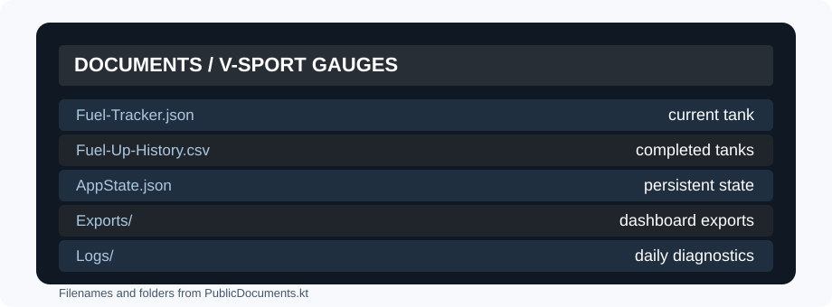
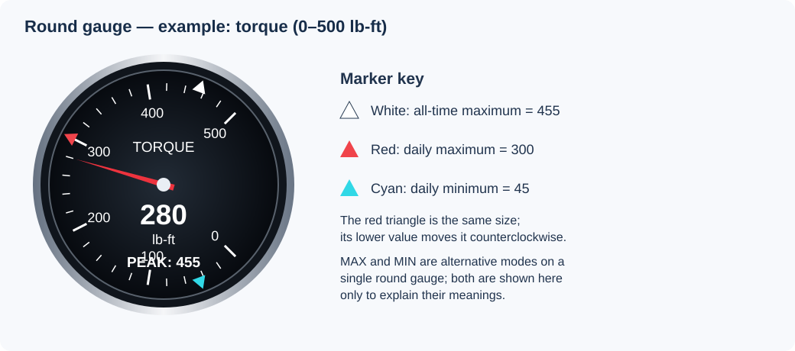
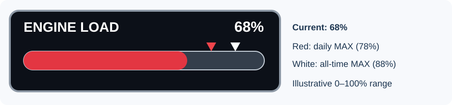
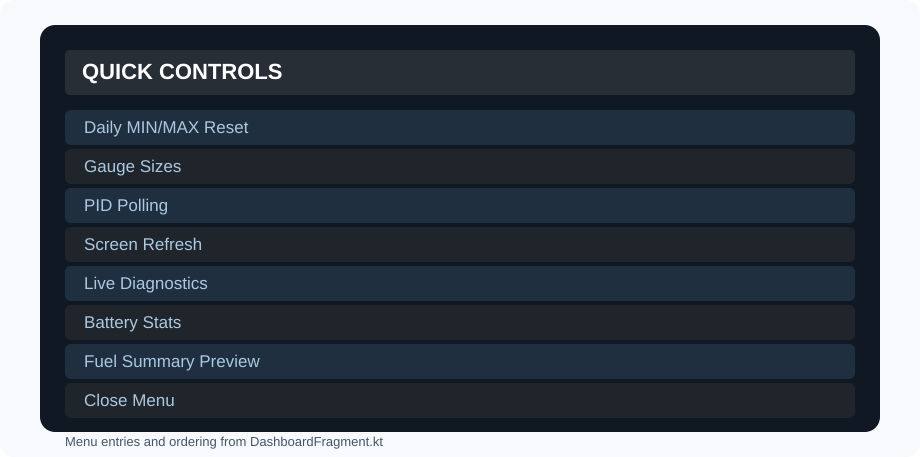
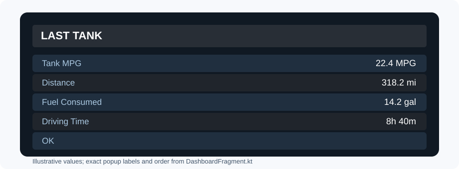
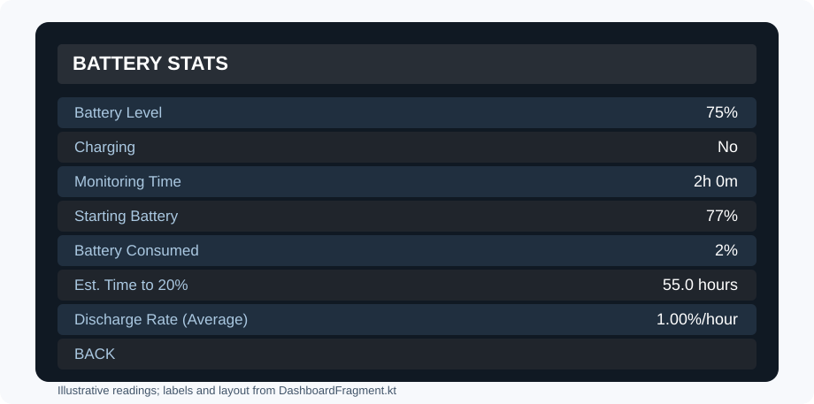

# V-Sport Gauges — User Guide

**For V-Sport Gauges 3.14.2** · [Back to README](../README.md) · [Development history](../README.md#the-development-of-v-sport-gauges)

This guide covers the **features and controls added to the original AA Torque app**, in the order a new user needs them: first-time setup, global settings, gauge configuration, and then the driving and monitoring features. Illustrations are explanatory diagrams based on current V-Sport Gauges source code, not photographs of the Android Auto screen.

## 1. First-time setup and Documents folder access

V-Sport Gauges builds on AA Torque. Install and configure **Torque Pro** and a compatible OBD-II adapter first, then install V-Sport Gauges on the host Android phone. This guide covers the controls and features added by V-Sport Gauges, rather than repeating the original AA Torque setup instructions.

### Authorize the Documents folder

1. Open **V-Sport Gauges** on the Android phone. If Android requests location permission, respond to the phone's permission prompt.
2. At the **V-Sport Gauges files** prompt, select **Select folder**.
3. In Android's folder picker, select the existing **Documents/V-Sport Gauges** folder—not Documents itself or a subfolder—and grant read/write access.
4. If the app finds a valid **AppState.json**, it recovers the saved application state. If recovery fails, the app reports the problem and preserves the original file.
5. The app checks for **Fuel-Tracker.json** and **Fuel-Up-History.csv**. If a file is missing, the **Missing fuel file** dialog offers **Create if missing**. Use this only when the file truly does not exist; an existing unreadable file must be repaired or restored rather than overwritten.
6. On reinstall, keep the Documents folder and select it again when prompted. The permission must be granted again after an uninstall.

Choosing **Later** postpones folder authorization and can prevent persistent file recovery or background fuel tracking until the necessary files are accessible.

| Location | Purpose |
| --- | --- |
| `Documents/V-Sport Gauges/Fuel-Tracker.json` | Current tank, daily driving totals, and completed-tank records |
| `Documents/V-Sport Gauges/Fuel-Up-History.csv` | Fuel-up history |
| `Documents/V-Sport Gauges/AppState.json` | All-time peaks, current-day records, gauge sizes, and phone battery statistics |
| `Documents/V-Sport Gauges/Exports/` | Exported dashboards |
| `Documents/V-Sport Gauges/Logs/` | Diagnostic logs |

The fuel tracker also maintains private recovery data. **Do not delete existing files during upgrades or reinstalls.**

## 2. Global settings and appearance

### Cadillac theme and font

On the Android phone, open **V-Sport Gauges → Settings → Appearance**.

- **Theme → Cadillac V-Sport** selects the Cadillac-named appearance, based on the Audi TT gauge theme.
- **Font → Cadillac Escalade** selects the Cadillac-named font option, based on Volkswagen Thesis.
- The header's **V-Series logo** appears with the Cadillac V-Sport theme. Choosing the font alone does not turn the logo on.

### Polling, refresh, and dashboard exports

**PID Polling** controls the configured Torque request interval (50–500 ms; default 200 ms). **Screen Refresh** controls gauge animation timing (50–500 ms; default 300 ms), not the PID request rate. Both can also be adjusted through Quick Controls.

The dashboard export/import feature preserves configured polling and refresh settings. Exported dashboards are stored under **Documents/V-Sport Gauges/Exports**; import uses Android's document picker. These settings are not duplicated in **AppState.json**.

## 3. Gauge configuration

These instructions cover the gauge settings and indicators added to the original AA Torque application. Other standard AA Torque gauge settings remain available.

### Round gauges

A round gauge displays its configured Torque Pro PID, label, units, scale, live numeric value and animated needle. Its tick marks are rendered by the app, not baked into a background photograph.

**Example:** the illustration shows a torque gauge with separate current, daily, and all-time readings. Marker positions follow the configured gauge scale; the example values are illustrative, not live vehicle measurements.

| Indicator | Meaning | Persistence |
| --- | --- | --- |
| **White triangle** | Highest saved all-time reading for the selected PID | Retained across sessions and restarts |
| **Theme-colored triangle** (red in the example) | **Daily maximum** when the round gauge's marker mode is **MAX** | New local calendar day starts a fresh daily record |
| **Cyan triangle** | **Daily minimum** when marker mode is **MIN** | New local calendar day starts a fresh daily record; RPM qualification required |
| **`PEAK: 455`** | Numeric **all-time** maximum, not the live value or daily record | Appears briefly on load; persists after a new all-time record until the gauge is reinitialized |

**Important:** A round gauge can show **MAX, MIN, or BOTH** daily markers. The diagram illustrates both colored triangles; the white all-time marker is independent.

#### Configure a round gauge

1. On the Android phone, open **V-Sport Gauges → Settings → Dashboards**.
2. Open the desired dashboard and select the **left, center or right round gauge**.
3. Select the **PID**. The selector includes Torque Pro session PIDs and four **V-Sport daily** virtual PIDs: Daily Distance (km), Daily Drive Time (s), Daily MPG, and Daily Fuel Used (gal), plus four **Trip 3** virtual PIDs: Trip 3 Distance (km), Trip 3 Drive Time (s), Trip 3 MPG, and Trip 3 Fuel Used (gal). Configure **Enabled**, **Show label**, **Label**, **Unit**, **Minimum**, **Maximum**, **Whole numbers**, and **Ticks** as needed.
4. Set **High/low markers** (`maxMarksActive`) to **Off**, **Max**, **Min**, or **Both**. This controls the colored triangle. The marker color is theme-dependent for MAX; MIN is cyan.
5. Set **High/low values** (`maxValuesActive`) independently if you want the separate numeric high/low readout. This is **not** the `PEAK:` all-time label.
6. Enable **Show all-time peak marker** to display the **white triangle** when a saved peak exists.

These **high/low selectors are available for round gauges**. They are intentionally hidden in the **horizontal-gauge** settings, where daily MAX is handled separately.

#### Saved all-time peak and the `PEAK:` label

- All-time values are saved against the complete Torque PID identifier and can be shared by gauges using that PID.
- **Show all-time peak marker** controls visibility of the **white triangle**, not whether the app records a peak.
- **All-time peak value** displays the saved value for the PID and lets you **manually enter a replacement**. Entering **0** stores a zero-valued peak (it does **not** delete the saved record). A subsequent higher valid reading can then establish a new maximum.
- When a saved peak is loaded, **`PEAK: <value>`** appears for approximately **three seconds**.
- When a **new all-time maximum** is reached while the all-time marker is enabled, the `PEAK:` label remains visible until the gauge is reinitialized. It is not a continuously displayed live measurement.

#### Daily minimum startup protection

A candidate daily minimum is not accepted immediately. The app checks that **RPM exceeds 300**, waits **five seconds**, and checks **RPM above 300** again before recording that candidate. It does **not** monitor RPM continuously between the checks. This avoids accepting an unqualified low reading during engine startup.

Daily records are scoped to the **local calendar date** and the PID/conversion. They do not replace the saved all-time maximum.

#### Daily record notification

Daily MIN/MAX records continue updating with every accepted improvement. The round gauge's unit label blinks for **3 seconds** (half a second visible, half a second hidden) only when the record improves by at least **5% of that gauge's configured range** relative to the last notification baseline, and at least **60 seconds** have passed since that PID/direction last blinked. The first observed record establishes a baseline without blinking. Improvements during cooldown are recorded but do not queue a later notification; a subsequent qualifying record change is needed. MIN and MAX are gated independently, and dashboards sharing a PID/conversion share notification state during the app session. This notification does not alter the live numeric value, needle, daily triangles, or all-time `PEAK:` label.

### Statistical modifiers — Trend and Rolling Average (3.15)

Each gauge can optionally apply a time-based modifier to its selected PID. **Trend** shows the change over the selected time window; **Rolling Average** smooths the readings over that window. The modifier operates on the reading after the gauge's configured unit conversion, so the result uses those configured units.

1. On the Android phone, open **Settings → Dashboards**, select the dashboard, then open the desired gauge or numeric display.
2. Configure the PID and **Units** first. In **Statistical Modifier**, enable **Enable Modifier**.
3. Open **Modifier Type** and choose **Trend** or **Rolling Average**.
4. Set **Time Window (seconds)** to a whole number from **1 to 3600**. The default window is **30 seconds**.
5. Return to the dashboard. Modifier settings are stored with each display and retained by dashboard export/import. Disable **Enable Modifier** to show the normal reading again.

While a modifier's observation window is still filling, the displayed numeric value is **cyan**; it becomes white after the window is established (unless an alarm changes its color). A new observation window can be needed when monitoring starts or resumes. Trend measures change over time, not the original PID's absolute value; Rolling Average reports the mean of readings within its window. The modified display should not be interpreted as an instantaneous ECU measurement.

### Horizontal gauge — one per dashboard

The horizontal gauge has its **own configuration on each dashboard**, rather than a global horizontal-gauge setting.

1. On the phone, open **Settings → Dashboards → [dashboard] → Horizontal Gauge**.
2. Select its PID, label, unit, minimum and maximum, and choose whether to show the label, whole numbers and tick marks.
3. Use **Show all-time peak marker** for the **white all-time triangle** on the bar.
4. The bar tracks a **daily MAX** marker independently of the round-gauge MIN/MAX choice. The filled portion follows the **current reading**, not the peak.
5. The current numeric reading displays the configured unit **without an added space** (for example, `68%`).

**Bidirectional ranges (3.16):** If the horizontal gauge's **Minimum** is negative and its **Maximum** is zero or positive, the fill starts at **zero** and extends right for positive readings or left for negative readings. The scale includes a **zero major tick** even when regular tick spacing would not place one there. For example, a range of **−100 to +100** fills from the midpoint toward the current reading; a range of **0 to 100** retains the normal left-to-right fill. This behavior is automatic from the configured minimum and maximum; there is no separate bidirectional toggle.

The bar's appearance, tick marks and colored peak marker are theme/rendering dependent. The diagram is a functional explanation, not a screenshot. The horizontal settings intentionally do **not** expose round-gauge MIN/MAX selectors.

## 4. Features and on-road operation

### Dashboard navigation and startup

#### Change dashboards and views

- **Swipe horizontally** across the dashboard to switch between configured dashboards.
- **Rotary/directional inputs** can also change dashboards: left/up and right/down navigate in opposite directions.
- **Vertical swipe** or the supported **center/select button** toggles the alternate chart view.
- Dashboard titles, round gauges, four smaller display fields and horizontal gauge are configured for each dashboard on the phone.
- The **clock and direction** remain part of the dashboard header while ECU data is being connected. The **V-Series logo** also remains visible during connection when Cadillac V-Sport is selected; it is hidden for other themes. A connection-state/title change should not require the entire layout to move.

The precise vehicle rotary mappings can vary by Android Auto receiver; the list above describes the events handled by the app code.

#### Clock, travel direction, and startup

- The **clock** comes from the phone, not a Torque Pro PID.
- **Travel direction** is derived from phone GPS movement; when a fresh direction is unavailable, the last known direction is retained.
- Engine data requires **Torque Pro**, a working OBD connection, and the requested PID. The gauges may wait for ECU data while the header remains visible.
- The app considers the ECU **connected** after receiving a qualifying nonzero reading; a zero-only stream may still display as waiting. That status rule does not mean every legitimate zero value is invalid.

### Quick Controls

Press the rotary controller to open Quick Controls, rotate to choose an item, and press to select. In the test screen, hold the clock for three seconds to open the same menu, then tap items. The previous logo and round-gauge long holds are no longer assigned.

**Polling & Refresh → PID Polling** opens the existing 50–500 ms polling slider (default 200 ms). It controls the request interval, not necessarily the measured per-PID update rate.

**Polling & Refresh → Screen Refresh** opens the existing 50–500 ms gauge animation slider (default 300 ms). It changes needle transition timing, not ECU polling. SAVE retains a value and CANCEL restores the previous one.

**Gauge Sizes** selects all round gauges or the center gauge. The three modes are all normal (100%), center enlarged (110%), and all enlarged (110%). The horizontal gauge is not scaled.

**Daily MIN/MAX Reset** clears today's MAX, MIN, or both, across all dashboards sharing PID identities. Reset requires confirmation and does not affect saved all-time peaks.

**Live Diagnostics** displays polling, timing, connection, and data-quality information. It also shows the existing connection-state summaries. It does not show the application version.

Ordinary Quick Controls pages close after five seconds without interaction. Live Diagnostics and Battery Stats remain open until explicitly dismissed. A timeout cancels unconfirmed resets and unsaved slider adjustments.

#### Exporting and importing PID polling settings

Settings export includes the manually selected **PID Polling Interval** as well as gauge animation settings. Import restores the saved polling interval and applies it to active polling. Older exports without this setting use the 200 ms default. The polling slider reflects the restored value after import.

### Live Diagnostics display

Select **Live Diagnostics** from Quick Controls to open the two-column, six-tile panel. Values refresh approximately once per second while the panel is open. No extra ECU requests are issued.

| Display | What it reports |
| --- | --- |
| **PID Polling Target** | Configured PID request interval, in milliseconds; a target, not a measured rate |
| **Actual PID Rate** | Number of successful accepted PID polls per second across active gauge requests, measured over the preceding display interval |
| **Torque Response** | Time spent retrieving the last PID value from Torque's API, in milliseconds; not confirmed ECU latency |
| **Last PID Age** | Time since the most recent accepted PID reading; a dash appears until one is received |
| **Stale Data** | Cumulative count and whole-number percentage of PID validation results with an unchanged source timestamp |
| **Suspect Data** | Cumulative count and whole-number percentage of PID validation results that failed validation, including unavailable connection, invalid values or invalid timestamps |

The six tiles are grouped by polling, timing, and data quality. The existing ECU status line, **Torque Connection** and **Data Stream** rows retain their original connection-state logic and placement. A **Monitoring** status does not by itself establish fresh ECU data. Stale and suspect percentages are cumulative since app startup, not a live rolling-window percentage. The Screen Refresh setting remains available in Quick Controls even though its value is no longer displayed in Live Diagnostics.

The diagnostics screen deliberately **does not display the application version**. Use the phone's About/Info screen to find the version.

### Torque session trips and V-Sport daily statistics

The existing **Torque Pro Trip Distance, Trip Time, and Trip MPG** PIDs continue to represent Torque's own trip session. To show totals accumulated throughout the local calendar day, configure another dashboard with the four **V-Sport daily** PIDs from the same gauge PID selector. These are app-generated readings, not additional ECU requests.

Daily Distance and Daily Drive Time accumulate accepted trip-distance and trip-time changes across sessions in Torque's original units: kilometers (km) and seconds (s). To display miles or minutes, use the same gauge conversion formulas as for Torque's original trip PIDs (distance: `a * 0.621371192`; time: `a / 60`). Daily Fuel Used accumulates the accepted gallons calculated from Torque trip distance and trip MPG; **Daily MPG** is total daily miles divided by total daily gallons, not an average of individual trip MPG readings. The daily counters reset at midnight according to the phone's local date. They are separate from the tank totals and do not reset when a refill is detected. Both daily and tank totals are saved in `Fuel-Tracker.json`.

### Trip 3 — manually resettable trip totals

Trip 3 is separate from Torque Pro's session trip readings and V-Sport's midnight-reset daily totals. Select **Trip 3 Distance (km)**, **Trip 3 Drive Time (s)**, **Trip 3 MPG**, or **Trip 3 Fuel Used (gal)** in a gauge's PID selector. Trip 3 retains its accumulated totals across driving sessions and midnight boundaries. The fuel-used reading comes from the existing Trip 3 gallons total in `Fuel-Tracker.json`; Trip 3 MPG is calculated from accumulated paired distance and fuel used. To show miles or minutes, use the gauge conversions `a * 0.621371192` and `a / 60`, respectively.

To reset Trip 3 in the current 3.17.x controls, **press and hold for three seconds on a numeric display showing a Trip 3 PID** and then choose **Reset** in the confirmation dialog, or **Cancel** to preserve the totals. Reset clears Trip 3 distance, driving time, fuel used, and MPG and records a new start time. This reset is independent of the daily MIN/MAX reset in Quick Controls.

### Trip and fuel tank tracking

V-Sport Gauges accumulates tank information from **Torque Pro trip distance (ff1204), trip time (ff1266), and trip MPG (ff1205)**. It reuses available Torque trip readings instead of independently calculating distance or fuel economy from vehicle-speed or engine-fuel-rate PIDs. **Fuel level (012F)** is used to detect a refill.

Valid trip information is accumulated across driving sessions. Background monitoring can continue when Android Auto is not showing the gauges. While the vehicle is parked and the ECU is disconnected, the service can remain ready; new driving information requires available Torque and ECU data.

After a confirmed refill, the completed tank is retained in the history and a **LAST TANK** summary can appear with accumulated miles, driving time, and MPG. Select **OK** to dismiss it. For an interim view of the current tank, use **Quick Controls → Fuel Summary Preview**. Previewing does not complete or reset a tank.

The refill detector uses a persisted fuel-level baseline and multiple confirming readings to avoid reacting to a single fluctuation. Small top-ups may not reach the detection threshold.

### Background performance recording

**Dashboard 1** is the source for background performance monitoring. The app uses the PIDs configured in its three round gauges, four smaller displays, and horizontal gauge, where enabled. It does not switch background monitoring to whichever dashboard was last viewed.

When V-Sport Gauges is not visible—for example, while Android Auto shows Maps, or when the gauge screen was never opened during the drive—the existing background service can poll those Dashboard 1 PIDs when Torque Pro is available and the ECU is connected. Opening the gauge dashboard gives normal foreground polling priority; leaving it allows background performance polling to resume. Performance PID polling stops while the ECU is disconnected, while the existing connection checks remain active.

Accepted readings can update **daily MAX**, **daily MIN** (subject to the existing five-second RPM validation), and **all-time PEAK** records. All-time PEAK recording does not require the white peak marker to be visible. The saved records are available when the gauges are displayed again. The usual PID configuration, validity checks, and local-day record rules still apply.

This feature does not require opening Dashboard 1 before a drive, provided the background service has already been activated and its required file access is available. It does not change fuel and trip accumulation or phone battery monitoring.

### Host Android phone battery monitoring

**Battery Stats monitors the Android phone running V-Sport Gauges, not the Escalade's 12-volt battery.**

Open **Quick Controls → Battery Stats** to see **Battery Level**, **Charging**, **Monitoring Time**, **Starting Battery**, **Battery Consumed**, **Discharge Rate (Average)**, and **Est. Time to 20%**.

Battery consumption is measured during qualifying background monitoring while the ECU is disconnected and the phone is not charging. A completed measurement uses approximately two hours of qualifying monitoring. If conditions are interrupted, the measurement cycle resets; the last completed result remains available. The remaining-time figure is an estimate based on the observed discharge rate, not a guaranteed runtime.

### Persistent diagnostic logs

V-Sport Gauges automatically writes diagnostic logs to **Documents/V-Sport Gauges/Logs** on the host Android phone. Logging starts when the application starts; it does not wait for the folder-selection prompt. Android 10 and later uses the system media storage service for log files.

Events use the phone's **local time**. Daily filenames resemble `V-Sport-Gauges-20261117.log`; the next event after a date change starts the new day's log. A log larger than approximately **5 MB** rolls over to a `-partN` file. The logger retains up to eight matching files.

Logs capture connection events, PID issues, daily MIN/MAX and all-time PEAK changes, selected settings changes, and battery observations. Writing occurs off the PID polling thread.

### Data quality and calculated power

- V-Sport Gauges rejects **non-finite readings**, invalid converted values, certain shutdown sentinel values and readings **above twice the configured display maximum** before they update the gauge or peak records.
- Negative readings are **allowed** for PIDs that legitimately produce them. The visual gauge may clamp a reading to the dial minimum without changing the underlying value.
- This is a **plausibility filter**, not a guarantee that every ECU/adapter error is detected.
- Custom Torque Pro PIDs and formulas can supply calculated **horsepower and torque**. These are **ECU-based estimates**, not dynamometer measurements. Verify the PID definition, units and formula for your vehicle.

## 5. Troubleshooting

| Symptom | Check |
| --- | --- |
| Gauge stays empty or waiting | Torque Pro connection, adapter, ECU status, PID availability and whether any nonzero value has arrived |
| White peak triangle missing | The gauge's **Show all-time peak marker** option and whether a saved value exists |
| `PEAK:` number disappears after startup | Expected: a loaded all-time peak is shown for approximately three seconds |
| Red/cyan marker absent | Round-gauge **High/low markers** mode; daily record may not yet exist |
| Daily MIN not updating | Two qualifying RPM readings **above 300**, five seconds apart |
| Peak marker unexpectedly at end of scale | Check PID formula, units, saved peak and configured maximum |
| Gauge freezes after a spike | Check PID formula, display maximum and the implausible-reading filter |
| Polling slider changes response time | This is expected: polling actually reschedules diagnostic requests |
| Needle slider changes animation but not PID speed | This is expected: animation and polling are independent |

### Connection indicators

During startup, **Connecting to ECU** appears with a small cyan rotating spinner when Torque is available but ECU communication is not yet established. The spinner and message are centered together and disappear when the existing connection state reports connected.

The amber **Broken Link** symbol appears beside the time and direction display if the app remains in **Connecting to Torque** for five seconds. It clears immediately when Torque connects; it stays hidden during normal **Connecting to ECU** startup. After ECU connection, three consecutive unsuccessful Torque PID requests for an active gauge cause the indicator to appear; a successful response for that gauge clears its failure streak. The symbol disappears when no active gauge has a persistent request failure.

The indicator reports detectable Torque service/PID request failures. It does not prove that Torque's adapter or ECU is connected, and valid zero readings alone do not trigger the warning. The existing **Connecting to ECU** text remains a startup-only message.

### Scope

This guide covers the application's controls and features, including `DashboardFragment.kt`, `TorqueGauge.kt`, `TorqueLoadBar.kt`, `TorqueRefresher.kt`, `TorqueData.kt`, `DailyPeakStore.kt`, `AllTimePeakStore.kt`, `SettingsPIDFragment.kt` and the settings XML.

The original AA Torque features (themes, alarms, formulas, dashboard fields and chart views) remain available subject to their own configuration. For the history of additions, revisions and removed experiments, see the [development history](../README.md#the-development-of-v-sport-gauges).
